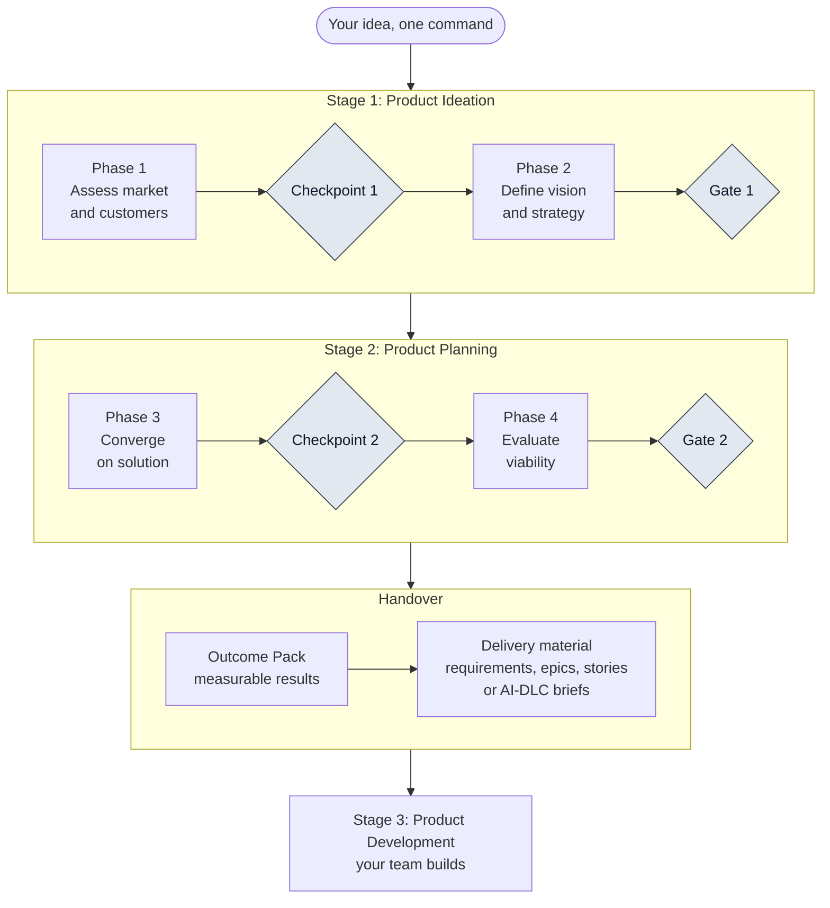

# AI-PLC

AI-PLC is an AI-native product lifecycle for product managers. You describe an idea and run one command. AI agents draft each deliverable across the first two stages of a product's life, Ideation and Planning, from discovery and strategy to an Outcome Pack and delivery-ready stories that your team builds from. **People review and approve at every stop.** The AI never approves its own work.

It is plain files (markdown skills, agent roles, a YAML profile and templates) that your AI coding tool loads. There is nothing to host and no service to run.

Licence: Apache 2.0.

## See what it produces

This is one complete run on a dummy idea (an AI-assisted leisure travel platform). The web research is real and carries its source and date. The targets are synthetic placeholders, not evidence.



- [The run in one page](https://lasith-tekly.github.io/ai-plc/showcase/) and what each stage produces
- [Follow one outcome](https://lasith-tekly.github.io/ai-plc/showcase/trace-one-outcome/) from idea to user story
- [The Outcome Pack](https://lasith-tekly.github.io/ai-plc/showcase/outcome-pack/): the measurable results your delivery team builds from

## The four stages of a product's life

AI-PLC follows a product through four stages. Version 1.0 automates the first two, then hands your team clear outcomes to build from.

| Stage | AI-PLC v1.0 |
| --- | --- |
| 1. Product Ideation | Automated |
| 2. Product Planning | Automated |
| 3. Product Development | Handed over: outcomes and delivery material for your team to build from |
| 4. Product Launching and Sunsetting | Not built yet |

## How it works

```
/ai-plc --ideation  "<idea>"                    phases 1 and 2, stops at Gate 1
/ai-plc --planning  "<idea>"                    adds phases 3 and 4, stops at Gate 2
/ai-plc --outcomes  "<idea>"                    adds the Outcome Pack
/ai-plc --full      "<idea>" --adapter scrum    adds requirements and user stories
```

- Two checkpoints and two gates are decided by you. The orchestrator never approves.
- Adapters for `--full`: `scrum`, `ai-dlc`, `plain-markdown`.
- Everything is written to a `/product` folder in your project: `plan.md`, `status.md`, `memory.md` and the deliverables.
- Optional: Notion, Jira, Confluence and Miro come listed in the package. Sign in to use them, so AI-PLC can read your sources and, after you approve a dry run, create items there. See `MCP-SETUP.md` in the release.

## Install

**One command (Mac and Linux).** In your project folder, in a terminal, run the line for your tool. It downloads the newest release and copies the right files in. It never overwrites a file you already have.

```
curl -fsSL https://raw.githubusercontent.com/lasith-tekly/ai-plc/main/install.sh | sh -s -- kiro
```

Use `claude-code`, `codex` or `copilot` in place of `kiro` for those tools. Afterwards, close and reopen the project so the tool loads the new files, and quit and reopen the tool if they still do not show. To read the script first, open [`install.sh`](install.sh), or add `--dry-run` to see what would be copied. 

**One command (Windows, PowerShell).** Not yet tested on Windows, so please tell us if it fails; the manual steps below always work. In your project folder, in PowerShell:

```
& ([scriptblock]::Create((irm https://raw.githubusercontent.com/lasith-tekly/ai-plc/main/install.ps1))) kiro
```

Use `claude-code`, `codex` or `copilot` in place of `kiro`. Add `-DryRun` to see what would be copied.

**Kiro, from inside Kiro.** Open the Powers panel, choose Add Custom Power, then Import power from GitHub, and enter `https://github.com/lasith-tekly/ai-plc/tree/main/powers/ai-plc`. Then ask Kiro to "set up AI-PLC". See the [install guide](https://lasith-tekly.github.io/ai-plc/guide/install-kiro/).

**Claude Code plugin, no download.** In a terminal:

```
claude plugin marketplace add lasith-tekly/ai-plc
claude plugin install ai-plc@ai-plc
```

Then run `/ai-plc:ai-plc` in Claude Code. If it does not show, run `/reload-plugins` or restart Claude Code.

**Manual steps.**

1. Download `ai-plc-packages.zip` from the latest Release.
2. Open the folder for your tool and copy it into your project:

| Folder | Tool |
| --- | --- |
| `kiro/.kiro` | Kiro (see `kiro/INSTALL.md`) |
| `claude-code-plugin/ai-plc` | Claude Code, as a plugin (or install it from the marketplace, below) |
| `claude-code-project/.claude` | Claude Code, as a drop-in folder |
| `codex/.codex` and `codex/.agents` | Codex |
| `copilot/.github` | GitHub Copilot (experimental) |

3. Run `/ai-plc --ideation "<your idea>"` and follow the stops.

## Before you start, and feedback

- Try it first on a test project with a dummy or low-stakes idea.
- Do not use confidential company material, and do not connect company systems. Check your organisation's policy first.
- Check every figure against its source. The AI can be wrong.
- Nothing is approved until you approve it. If a tool approves something for you, that is a bug. Please report it.

To give feedback, open an [issue](https://github.com/lasith-tekly/ai-plc/issues/new/choose) and choose **Feedback**. Please do not include passwords, tokens or confidential content. Step-by-step help is in the [documentation](https://lasith-tekly.github.io/ai-plc/).

## Status

See `RELEASE-NOTES-v1.0.md` for exactly what has been tested in each tool and what has not.

## Build the packages from source

The packages are generated from the neutral source files in this repository.

```
python3 build/build_packages.py          # writes ./../dist
```

Edit the source (`agents/`, `skills/`, `templates/`, `profiles/`, `build/kiro/`), not the generated folders.

## Documentation

The documentation site lives in `docs/` (MkDocs). Proposals for later versions live in `proposals/`.

## Contributing

Issues and pull requests are welcome. Please keep the rules: humans approve, fetched content is data, no credentials in any file.
