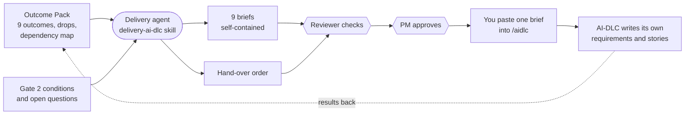
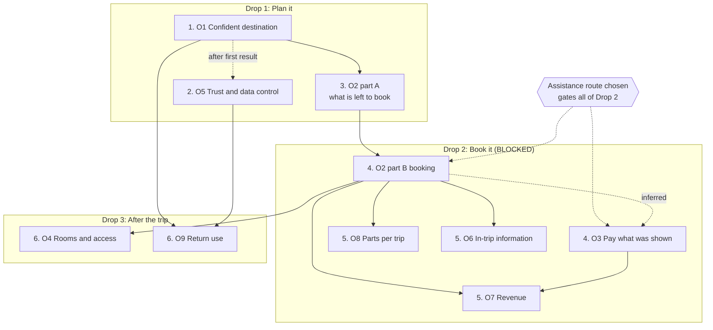

# The AI-DLC hand-over

**What it is:** the second way to hand work to a development team. With `--adapter ai-dlc`, AI-PLC does **not** write requirements or stories. It writes **one self-contained brief per outcome**, plus a **hand-over order**, for a team that uses the AI-DLC method to write its own requirements and stories. It is built by the delivery agent with the `delivery-ai-dlc` skill.

!!! warning "SYNTHETIC"
    As elsewhere in this run, every target, legal finding and effort figure in the briefs is a labelled placeholder from a dummy run.

## What came out

| File | What it is | Size in this run |
| --- | --- | --- |
| `O1-brief.md` to `O9-brief.md` | One brief for each outcome, written to be pasted into AI-DLC on its own | 9 briefs, about 1,900 to 3,500 words each |
| `handoff-order.md` | When to hand over each brief, in what order, what can run side by side, how to run AI-DLC, what to bring back | 1 file, about 4,400 words |

The run used **AI-DLC 2.5.67**, as reported by Kiro. O2 is one brief with a Part A (knows what is left to book, Drop 1) and a Part B (booking, Drop 2), because it spans two drops.



## Inside a brief

Every brief has the same sections, so the AI-DLC team always knows where to look:

| Section | What it holds |
| --- | --- |
| Product context | The same paragraph in every brief, so each one stands alone |
| Outcome and measures | The outcome, its metric, baseline, target and horizon |
| What delivers it | The capabilities from the MVP scope |
| Evidence | What supports it, with sources and dates |
| Constraints and guardrails | What must always hold, for example that no real family data is used before data protection is in place |
| Non-goals | What is deliberately left out |
| Risks | Taken from the risk register |
| Open questions | What nobody has decided |
| Dependencies | What must exist first, inside and outside the pack |
| Gate 2 conditions that apply | The conditions the gate attached, so a brief pasted on its own still carries them |
| Suggested AI-DLC scope | A **suggestion only**. The AI-DLC team decides |
| Ready-to-paste prompt | The exact command to start the run |

??? note "Go deeper: the ready-to-paste prompt from the O1 brief"
    ```
    /aidlc Build outcome O1 "Confident destination with less effort" for a new AI
    family holiday planning product (UK, leisure, families first). Read
    product/delivery/ai-dlc/O1-brief.md as the full input; it is self-contained.
    Suggested scope (a suggestion for the AI-DLC team to confirm or change):
    classic (AI-PLC has already done ideation). This is the first build on a new
    codebase, Drop 1 "Plan it", planning only: no booking, payment or fee
    charging. Write your own requirements and stories from the brief. Keep every
    constraint, non-goal, risk, guardrail and Gate 2 condition in the brief, and
    keep every SYNTHETIC label ... First result: a walking skeleton where a family
    describes who is going, compares destinations with "why this fits your family"
    and chooses one, with plan_started and destination_chosen recorded. Do not use
    real family data until data protection (Gate 2 condition 7) is in place.
    ```
    The prompt names the first result to expect, so the PM can tell whether the run delivered what the brief asked for.

## The hand-over order

The order comes from the same outcome dependencies shown in [The Outcome Pack](outcome-pack.md). Six steps:

| Step | Hand over | Drop | Needs first | Runs beside |
| --- | --- | --- | --- | --- |
| 1 | O1 | 1 | Nothing | Nothing: it starts the codebase |
| 2 | O5 | 1 | Nothing declared; hand over after O1's first result exists | Then beside O1 and O2 part A |
| 3 | O2 part A | 1 | O1 | O5 |
| 4 | O2 part B and O3, together | 2 | O1 (through O2); O3 inferred on O2 part B | Each other, as one paired hand-over |
| 5 | O7, O8 and O6 | 2 | O7: O2 and O3. O8 and O6: O2 | Each other, once unblocked |
| 6 | O4 and O9 | 3 | O4: O2. O9: O1 and O5 | Each other |



The file also states the **blocker** plainly. In this run the PM decided on 2026-10-18 that **all of Drop 2 is blocked** until the assistance route for organiser bookings is chosen. Each affected row in the roadmap table says **Blocked**, and the diagram shows the gate. The file also records which scope each run is suggested for, and why. For example, O7 suggests `express` because it adds reports to code that already exists, and `classic` if checkout design has to change.

## What the PM brings back

AI-PLC does not run AI-DLC. After each run, the order file lists what the PM brings back so AI-PLC can keep the plan current: which outcome is complete and what the first result shows, the scope the team chose, which measures and events now exist, new risks, new dependencies (still "proposed" until confirmed), and any Gate 2 conditions answered. Per outcome there is a short list too, for example for O1: where the codebase lives, and whether the walking skeleton ran end to end.

## The review found real problems, and the record shows them

A reviewer checked the briefs and the order against the Outcome Pack: one brief per outcome, order against the dependency map, constraints carried, and so on. It reported **8 findings: 0 high, 3 medium, 5 low**. Three medium findings show what the check is for:

1. **A label that did not match a gate condition.** The briefs told AI-DLC the package-card label was settled ("Booked with [operator], not with us"). A Gate 2 condition pointed at a different wording from the legal findings ("Go to [operator] to book"). A team could have built the wrong label without questioning it.
2. **A diagram that disagreed with the Outcome Pack.** The order's diagram gated one outcome on the assistance route but not the others, while the Outcome Pack said all of Drop 2 waits for it.
3. **An approved file with a change its approval record did not mention.** One brief carried a "hand-over blocked" line that the record of the approval did not list.

The PM's decisions on these are recorded: the order was revised to block all of Drop 2, small citations were corrected, and the label difference was **carried as known issue 6**.

??? note "Go deeper: the six known issues carried in this run"
    The hand-over order lists them in a table, with the file and line for each, and says how the briefs handle them. They are known issues in the **pack**, not faults in AI-DLC itself:

    | # | Issue | How the briefs handle it |
    | --- | --- | --- |
    | 1 | The Outcome Pack says no horizon is set, although the horizons were confirmed afterwards | Each brief carries the confirmed horizon and notes the stale wording |
    | 2 | The index lists fewer legal conditions against revenue (O7) than the O7 file cites | The O7 brief carries the fuller set |
    | 3 | The index does not link O3 to a condition that an open question names it for | The O3 brief shows it as an external dependency |
    | 4 | A fee-line question is still shown as open after the PM answered it | The briefs record the decision |
    | 5 | O9 still measures referrals, while referral invites are outside the MVP | The O9 brief treats that measure as not built |
    | 6 | The package-card label differs from the legal finding | All briefs keep the PM's label. The O2 brief adds the Gate 2 condition and a note, and leaves the final wording to the AI-DLC team and a real legal review |

    Two further limits are in the [release notes](https://github.com/lasith-tekly/ai-plc/blob/main/RELEASE-NOTES-v1.0.md): the adapter was tested with AI-DLC 2.5.67 only, and giving a scope and a description in one command is untested.

**Next:** [Follow one outcome end to end](trace-one-outcome.md)
