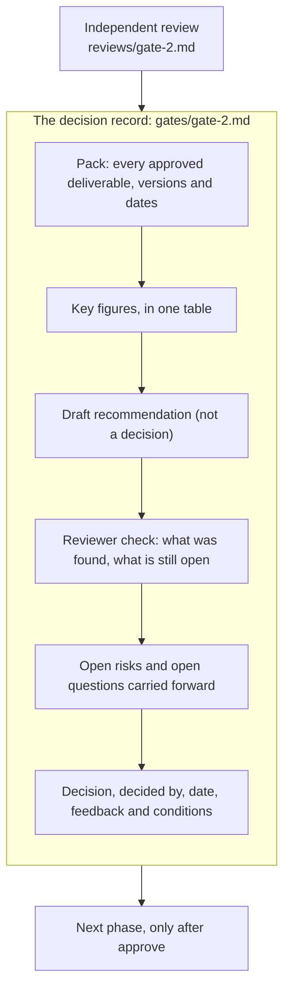

# Decisions and reviews

AI-PLC drafts and recommends. **People decide.** This page shows how that works on the real records from the run: four decision records, and the independent reviews that came before them.

!!! warning "Dummy run"
    The decisions below were made on a dummy run. The people reported approvals to test the model, and the data from phase 3 onward is SYNTHETIC. They show how the process works, not what a good decision looks like.

## Four stops, each with a record

| Stop | Closes | Decision pack | Decided | Outcome | Reviewer found first |
| --- | --- | --- | --- | --- | --- |
| Checkpoint 1 | Phase 1 | The four phase 1 deliverables | PM and senior management, 2026-10-15 | Approve, with the feedback "Only leisure travel" | No review file in this folder |
| Gate 1 | Phase 2, and Stage 1 | 2.10 Initial business case | Senior management, 2026-10-15 | Approve, no conditions reported | No review file in this folder |
| Checkpoint 2 | Phase 3 | The six phase 3 deliverables | Senior management, 2026-10-16 | Approve | **18 findings** (3 high, 6 medium, 9 low) |
| Gate 2 | Phase 4, and Stage 2 | 4.10 Final business case | Senior management, 2026-10-16 | Approve (the AI draft said rework) | **15 findings** (0 high, 7 medium, 8 low) |

Each record is a file in `gates/`. It begins with the sentence: *"This file records what the PM reports in chat. It is a record, not proof. The orchestrator does not make this decision."* The decision is written down exactly as it was reported, together with who made it and when. If a person gives no conditions, the record says "none reported". It does not fill the gap.

## What a decision record holds

## The AI recommended rework. People approved.

This is the clearest example of the principle. The final business case (4.10) was drafted with a **recommendation of "rework"**: the case did not show the product earning back its cost, and its only revenue source could not switch on under the proposed support model. It also set out two other readings, **limited approve** and **stop**, with what speaks for and against each.

Senior management reported a **full approve**. Gate 2 records it plainly:

> Outcome: approve (full approve, not the limited variant; differs from the 4.10 draft recommendation of rework). Feedback and conditions: none reported. The 4.1 conditions and 4.2 proposals the PM accepted earlier remain on record; whether the gate attached them was not stated.

Both facts are kept in the file: what the AI recommended, and what people decided. Nothing was changed to make them agree.

??? note "Go deeper: the Gate 2 key figures table (all SYNTHETIC inputs)"
    | | Low | Mid | High |
    | --- | --- | --- | --- |
    | MVP build, 4 months | £170,531 | £195,283 | £235,398 |
    | First 12 months after the MVP | £460,010 | £530,248 | £834,856 |
    | Revenue per booked trip (on-platform only) | £31 | £106 | £238 |
    | Break-even booked trips a year, with contingency | never | 11,914 | 4,371 |
    | Cumulative cash after 3 years | −£1,532,162 | −£1,322,968 | +£758,110 |

    The pack states which cost lines are SYNTHETIC, where the figures come from, and that the arithmetic is the tool's own. The independent reviewer then recomputed them.

??? note "Go deeper: what the pack carries forward at Gate 2"
    - **Open risks (8):** everything rests on SYNTHETIC tests; booking cannot switch on under AI-only support for organiser bookings; mid and low cases do not pay back within 3 years; every revenue input is assumed; supplier and payment clearances not started; effort does not fit four months for the fuller variant; the PM is a single point of failure; the marketing budget is small against the volumes needed.
    - **Open questions (13):** the assistance route for organiser bookings (the one most likely to change the case), fee amounts, service running options, a back-up decision-maker, funding for the cash low point, partners, the AI model provider, mobile format, a revenue fallback, the organiser model under a 2027 rule change, real reviewers, real targets, and who makes the launch decision after the pilot.
    - **Conditions proposed for any approval (12 from 4.1, 2 from 4.2):** for example real reviewers replace the synthetic findings, insolvency protection in force, data protection before real family data, and no live booking before a real usability round.

## The independent reviewer

Before every checkpoint and gate, a **new reviewer agent**, one that did not write the files, reads the approved deliverables. It is told to **find problems and report them, not to fix them**. Each report in `reviews/` opens with a "look at these first" list so the PM spends time on what matters.

| What it checks | How |
| --- | --- |
| Arithmetic | Recomputes unit economics, break-even and cumulative cash from the files' own inputs |
| Counts | Recounts from the files, not from the summaries in them |
| Traceability | Every outcome reaches requirements and stories; every story traces up |
| Consistency | Whether files agree with each other and with the decision record |
| Labelling | Whether SYNTHETIC data is labelled and never presented as fact |
| Sources | Spot-checks that sources say what the files say they say |

??? note "Go deeper: what the Checkpoint 2 review found"
    The reviewer found three high-severity issues, and the first two are the kind a person is unlikely to catch:

    1. **A decision that existed in one file but not in the decision record.** The MVP scope (3.6) was approved, but `memory.md` and `status.md` did not record it. So phase 4 would not have read it as decided.
    2. **A scope choice that conflicted with a legal duty.** One scope choice made the platform a package organiser. The package travel regulations then require help to find alternative arrangements. The MVP offered AI-only help with no rebooking and no person. (A SYNTHETIC finding, but a good example of what the check is for.)
    3. **Revenue and card-fee figures built on an assumption that had since changed.** Flights had moved to a hand-off to another provider, but the figures still assumed flights were sold on the platform.

    It also reported that the labelling held up well: every figure derived from the synthetic tests carried the label.

??? note "Go deeper: what the Gate 2 review found"
    The reviewer recomputed the unit economics, break-even, net cash and cumulative cash for all three scenarios and they matched. Its first points:

    - **M2:** the final business case told the gate that the PM had accepted the legal conditions, but the memory file recorded that as the AI's own reading of "App approved". The caveat was missing from the pack.
    - **M1:** a flight commission was counted in the three-year figures although the same case said flights would earn nothing. Removing it takes about £35,610 (mid) and £189,920 (high) out of the three-year totals.

    Some findings were resolved by PM decisions. The rest were **carried as known issues**, listed in the gate record with their ids. The fix pass was skipped because this was a dummy run. The record says so rather than hiding it.

## Reviews of the delivery material

Delivery output is checked the same way. The traceability review recounted every requirement, edge, story and roadmap step from the files and found "6 findings: 0 high, 1 medium, 5 low. Traceability holds from end to end." It confirmed no loops, no drop breaches, and a roadmap that respects every dependency, the co-release set and the release point. The plain-markdown review found its medium issue in the plain list: conditions and risks were given as ids only, so a team could not tell what "condition 12" meant without other files.

**Next:** [The Outcome Pack](outcome-pack.md)
