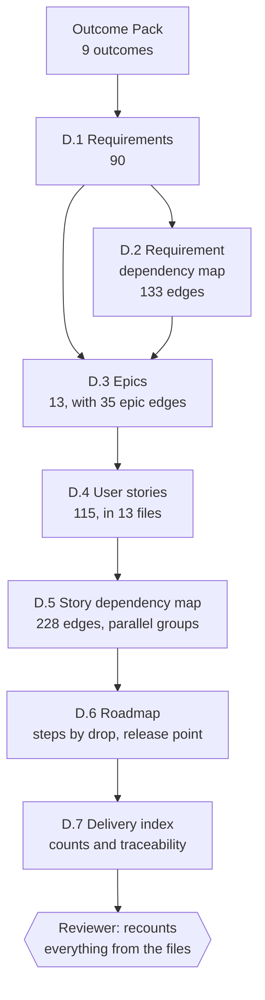
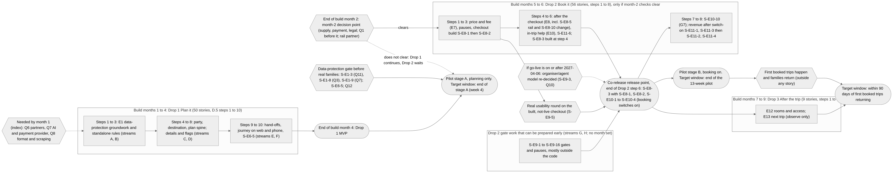

# Delivery material

**What it is:** the handover your development team works from. AI-PLC does not build the product (that is Stage 3). It prepares the material a team needs to start, in the working style you choose with `--adapter`.

| Adapter | What you get | Tested in this project |
| --- | --- | --- |
| `scrum` | Requirements, epics, user stories with acceptance criteria, dependency maps, a roadmap and an index | Yes, shown on this page |
| `ai-dlc` | Briefs for the AI-DLC method, in its own order | Yes (with AI-DLC 2.5.67 as reported by Kiro) |
| `plain-markdown` | One plain outcome list a team can use without any other tooling | Yes |

This page follows the **Scrum** run, because it is the most detailed. It is built by the **delivery agent** with the `delivery-scrum` skill, after the Outcome Pack is issued.

!!! warning "SYNTHETIC"
    The delivery files in this run rest partly on synthetic usability results, legal findings, effort and targets. Each one says so at the top, and individual stories carry the label.

## The seven pieces



| Piece | What it is | Size in this run |
| --- | --- | --- |
| **D.1 Requirements** | What the product must do, written so it can be built and tested. Each has a type, drop, source, and a note on what blocks it | 90 requirements |
| **D.2 Requirement dependency map** | Which requirement needs which, hard or soft, with reasons | 133 dependencies |
| **D.3 Epics** | Requirements grouped by what a family would notice. Never mixes drops | 13 epics, 35 epic dependencies |
| **D.4 User stories** | One file per epic. Each story has "As a... I want... so that...", acceptance criteria, and its dependencies | 115 stories |
| **D.5 Story dependency map** | Every story-level dependency, the co-release set, parallel groups | 228 dependencies |
| **D.6 Roadmap** | The order of work by drop, one row per group of stories that can run side by side | 3 drops, 21 steps |
| **D.7 Delivery index** | Counts, traceability and known issues, all read from the files | 1 file |

## Requirements: 90, in seven types

| Type | Drop 1 | Drop 2 | Drop 3 | Total |
| --- | --- | --- | --- | --- |
| functional | 14 | 14 | 3 | 31 |
| operational | 6 | 14 | 4 | 24 |
| legal | 3 | 10 | 0 | 13 |
| data | 4 | 4 | 0 | 8 |
| security and privacy | 5 | 1 | 1 | 7 |
| accessibility | 4 | 1 | 1 | 6 |
| performance | 0 | 1 | 0 | 1 |
| **Total** | **36** | **45** | **9** | **90** |

Legal, data, security and accessibility requirements are separate from functional ones, so they are not forgotten. Of the 90, 22 are blocked by an open item, and 23 carry a "SYNTHETIC basis" label.

??? note "Go deeper: real requirements from outcome O1"
    | ID | Requirement | Type | Source | Drop |
    | --- | --- | --- | --- | --- |
    | R-O1-1 | A parent can describe who is travelling (adults, children as age bands, needs) by conversation, quick taps or a form, and the product holds that party description for the plan | functional | O1; capability C1 | 1 |
    | R-O1-2 | For a described party, the product suggests and compares destinations, and each suggestion states why it fits that family before its price | functional | O1; capability C2 | 1 |
    | R-O1-3 | When the assistant is not sure of a fact it says so and names what to check; factual answers show their source and time | functional | O1; capability C8 | 1 |
    | R-O1-5 | Access, care and safety facts are shown as confirmed only when the supplier has confirmed them; otherwise the product shows "not known" and never infers them | legal | O1; 4.1 condition 9 | 1 |
    | R-O1-6 | Any such fact shown as confirmed that turns out false is logged, alerts the PM at once and pauses the pilot (threshold zero) | operational | O1; guardrail G3 | 1 |

    Each row's **Notes** column says what it supports and what blocks it, for example "'Why this fits' before price is a design change that rests on SYNTHETIC test results".

## Epics: 13, grouped by what a family notices

Drop 1 has six epics, Drop 2 five, Drop 3 two. The full table, with the dependency picture, is in [Dependencies at every level](dependencies.md#4-epics).

## User stories: 115

By drop: Drop 1 has 50 stories (6 blocked), Drop 2 has 56 (19 blocked), Drop 3 has 9 (0 blocked). 83 are written for a parent or family and 32 for the PM. Two (S-E8-1 and S-E8-2) are flagged as possibly larger than one sprint.

Every story has the same shape:

??? note "Go deeper: a complete real story, S-E2-4"
    ```markdown
    ### S-E2-4: Destination suggestions that say why they fit before the price
    As a parent, I want destination suggestions that tell me why each one fits
    my family before they tell me the price, so that I can choose with
    confidence and less effort (O1).
    - Outcome: O1 | Requirement: R-O1-2 | Epic: E2 | Drop: 1
    - Depends on: S-E2-1 (R-O1-2 → R-O1-1, hard); S-E2-6 (R-O1-2 → R-O3-7a, hard);
      S-E2-7 soft (R-O1-2 → R-O1-8, soft) (proposed)
    - Acceptance criteria:
      - Given a described party, when the parent asks for destinations, then the
        product suggests destinations for that party.
      - Given a suggestion, when it is presented, then the reason it fits this
        family, tied to what the parent said, comes before its price.
      - Given a suggestion shows a price, when it is presented, then the price
        carries the estimate label with source and time (S-E2-6).
      - Given Q8 is still open, when suggestions are made, then they use only
        partner or in-house content.
    - Constraints and risks carried: "why this fits" before price is a SYNTHETIC
      3.3 design change; no scraped prices and nothing from Booking.com; trust
      and uncertainty rules in E4 apply to suggestion text.
    - Estimate: not estimated
    - Open questions: How many suggestions per request? 3.2 step 4 proposes three
      to five; not a requirement. (PM)
    ```
    Notice three things. The **acceptance criteria** are testable, in the Given/When/Then form teams already use. The **dependencies** name the requirement edge each one comes from. And the story says **"Estimate: not estimated"**: the tool does not invent estimates or sprint lengths. It leaves those to the team.

## The roadmap

{ width="900" }

*The order of work, from the story dependencies.* [Open full size](../assets/showcase/roadmap.png){ target="_blank" }

The roadmap turns the story map into **steps**. All the stories in one step can run side by side, and a step needs only things from earlier steps. It uses only the times the PM confirmed (build months per drop) and leaves **sprints to be set by the PM**, because no team size or sprint length was given. It never turns the tool's own effort figures into a schedule.

??? note "Go deeper: Drop 1, steps 1 to 6 of the real roadmap"
    | Step | Stories that can run side by side | They need first |
    | --- | --- | --- |
    | 1 | 17 stories, including S-E1-7, S-E2-6, S-E4-1 to S-E4-3, S-E5-6, S-E5-9, S-E5-10, S-E6-3, S-E6-4, S-E6-6. Four are blocked by open questions (S-E1-1, S-E1-8, S-E2-7, S-E6-7) | Nothing from the plan, except open items Q11, Q3, Q8, Q12 |
    | 2 | S-E1-2, S-E1-4, S-E1-6, S-E1-9 | S-E1-1 |
    | 3 | S-E1-3, S-E1-5, S-E4-5 | S-E1-1 and S-E1-2; S-E1-4; S-E1-6 |
    | 4 | S-E2-1, S-E4-4 | S-E1-4 (and S-E1-5 soft) |
    | 5 | S-E2-2, S-E2-3, S-E2-4 | S-E2-1; S-E2-6 and S-E2-7 soft |
    | 6 | S-E2-5, S-E3-1, S-E4-8 | S-E2-4; S-E2-1 and S-E2-2 |

    Notice that nothing in the **Needs first** column is ever in a later step. That is the rule the reviewer checks.

??? note "Go deeper: the release point"
    Seven stories (S-E8-1, S-E8-2, S-E8-3 and S-E10-1 to S-E10-4) form a **co-release set**: booking and the in-trip help that the law requires with it cannot go live separately. The PM decided they are released together at **one release point, the end of Drop 2 step 6**. The four cost-tracking stories in E11 that depend on one of them are placed after that point. The roadmap says plainly that for those four stories the roadmap step replaces the step number in the story map, and that **no dependency was added or removed**.

## Plain-markdown adapter

The `plain-markdown` adapter produces **one file**, `outcome-list.md`: all nine outcomes once, in an order that respects every hard dependency and the drops, with a dependency table and a diagram that match the Outcome Pack. It is for a team that wants a list it can use without any other tool. The reviewer for this adapter found its medium issue exactly there: conditions and risks were listed as ids only, so a reader could not tell what "condition 12" meant.

## Handover to Stage 3

After this, your team builds. AI-PLC v1.0 ends at the handover: outcomes with measures, and the delivery material. Stage 3, Product Development, is yours, and Stage 4, Launching and Sunsetting, is on the [roadmap](../roadmap.md).

**Next:** [Follow one outcome end to end](trace-one-outcome.md)
