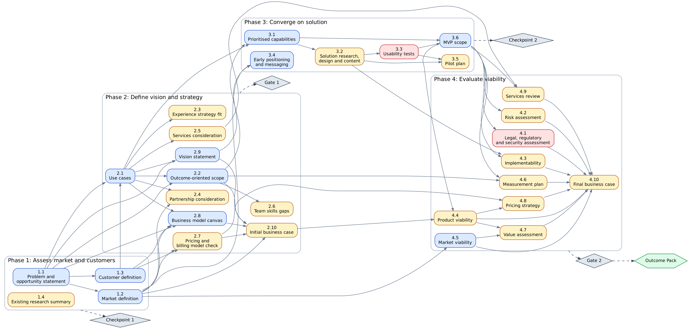
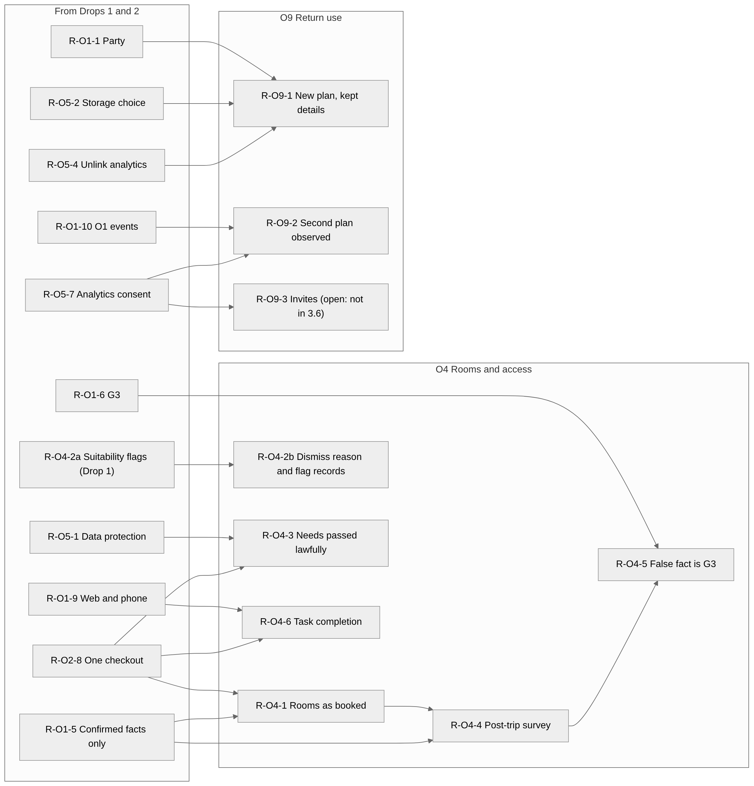
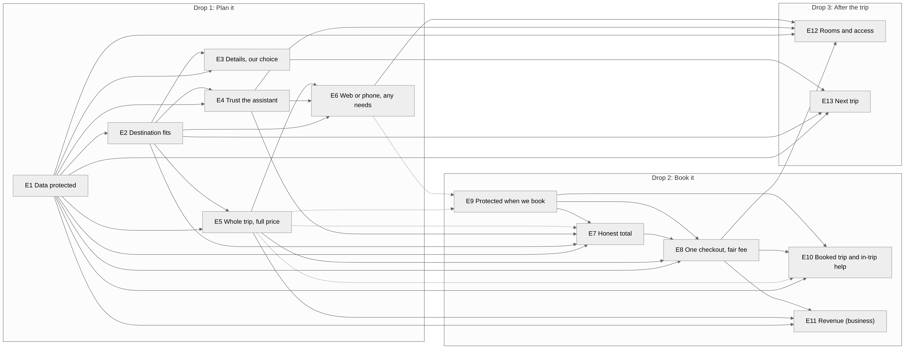
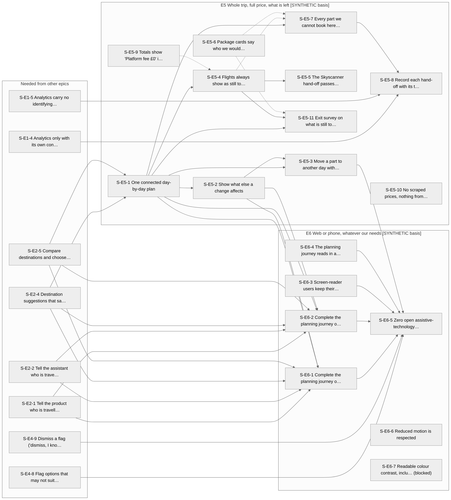

# Dependencies at every level

AI-PLC works out **what depends on what**, at every level from whole deliverables down to single user stories. That is what lets a team see the order of work, what can run in parallel, what is on the critical path, and what is blocked.

## Four levels, one method

| Level | What depends on what | Edges in this run | Where |
| --- | --- | --- | --- |
| Deliverables | Which earlier deliverables each one is built from | 58 | Header of every file (`depends_on`) |
| Outcomes | Which outcome must exist before another | 8 | Outcome Pack index |
| Requirements | Which requirement needs another | 133 | `delivery/requirements-dependency-map.md` |
| Epics | Which epic needs another | 35 | `delivery/epics.md` |
| User stories | Which story needs another | 228 | `delivery/story-dependency-map.md` |

At every level the same rules apply:

- **Hard or soft.** A *hard* edge means the second item cannot be built or tested without the first. A *soft* edge means it is better with it, but can start without it.
- **Every edge gives a reason and a source.** For example: "Suggestions are made *for a described party*", from the requirement text.
- **Every edge is `proposed`.** A person confirms them. The tool never presents a dependency as agreed.
- **Checks are run on the whole graph:** no loops, no item scheduled before something it depends on (a "drop breach"), and that items released together really can be.

## 1. Deliverables

{ width="900" }

*Blue: drafted automatically. Amber: drafted with the PM's input. Red: needs people outside the tool. Diamonds are decision points; the hexagon is the Outcome Pack.* [Open full size](../assets/showcase/deliverables.png){ target="_blank" }

This diagram was **generated from the files' own `depends_on` headers**, not drawn by hand. If a file's header changes, the diagram changes. Notice how 1.2 and 1.3 sit side by side because both need only 1.1, and how 2.10 and 4.10 gather many arrows into one: those are the decision packs.

## 2. Outcomes

{ width="760" }

Eight declared edges plus one inferred (dotted), no loops, three drops. Explained step by step in [The Outcome Pack](outcome-pack.md#outcome-dependencies).

## 3. Requirements

There are 90 requirements, written so a team can build and test them. Each has a type (functional, operational, legal, data, security and privacy, accessibility, performance), a drop, and a note on what blocks it. The map has 133 dependencies.

{ width="700" }

*A small part of the map: Drop 3's requirements (O4 and O9) and what they need from earlier drops, shown on the left. The full map is by drop.* [Open full size](../assets/showcase/requirement-dependencies-drop3.png){ target="_blank" }

??? note "Go deeper: real edges from the requirement map"
    | From | Needs | Kind | Why |
    | --- | --- | --- | --- |
    | R-O1-2 Destination suggestions | R-O1-1 Party description | hard | Suggestions are made "for a described party" |
    | R-O1-2 Destination suggestions | R-O1-8 Allowed content sources | soft | Partner and in-house content can be used while the scraping question is open |
    | R-O1-2 Destination suggestions | R-O3-7a Drop 1 prices labelled as estimates | hard | Every price that is not live from a partner must carry the estimate label |
    | R-O1-10 Time-to-destination events | R-O1-2 Destination suggestions | hard | The events need a destination choice to exist |

    The third row shows the tool **correcting itself**. In the first version this requirement pointed at one in a *later* drop, which is a drop breach. The PM decided to split that requirement in two, so the part Drop 1 needs sits in Drop 1. The change was recorded in a "Changes in v2" table in the requirements file.

## 4. Epics

Requirements are grouped into **13 epics** by what a family would notice: three to fifteen requirements each, and **no epic mixes drops**.

{ width="760" }

*Dependencies between epics, grouped by drop. Solid arrows are hard dependencies; dotted arrows are soft.* [Open full size](../assets/showcase/epic-dependencies.png){ target="_blank" }

| Epic | Drop | Requirements | Stories |
| --- | --- | --- | --- |
| E1 Our family's data is protected before we share it | 1 | 6 | 9 |
| E2 Find a destination that fits our family | 1 | 6 | 9 |
| E3 Our details, our choice | 1 | 3 | 4 |
| E4 Trust what the assistant tells us | 1 | 8 | 10 |
| E5 See the whole trip, its full price and what is left to book | 1 | 9 | 11 |
| E6 Plan on web or phone, whatever our needs | 1 | 4 | 7 |
| E7 See one honest total before we book | 2 | 6 | 8 |
| E8 Book the trip parts together in one checkout | 2 | 11 | 14 |
| E9 Protected when we book | 2 | 15 | 16 |
| E10 Our booked trip in one place, with help during the trip | 2 | 9 | 12 |
| E11 Know whether booked trips pay | 2 | 4 | 6 |
| E12 Rooms and access work for everyone | 3 | 6 | 6 |
| E13 An easier start to the next trip (observe only) | 3 | 3 | 3 |

## 5. User stories

**115 stories**, with **228 dependencies** between them. This is the finest level, and the one a development team plans sprints from. Every story names the requirement, epic, outcome and drop it comes from, what it depends on, and what blocks it.

{ width="800" }

*Story dependencies inside and between two Drop 1 epics (E5 and E6), with the stories they need from other epics on the left. Solid arrows are hard dependencies; dotted arrows are soft.* [Open full size](../assets/showcase/story-dependencies-e5-e6.png){ target="_blank" }

??? note "Go deeper: real edges from the story map"
    | Story | Depends on | Kind | Basis | Status |
    | --- | --- | --- | --- | --- |
    | S-E2-4 | S-E2-1 | hard | story field; requirement edge R-O1-2 → R-O1-1 | proposed |
    | S-E2-4 | S-E2-6 | hard | story field; requirement edge R-O1-2 → R-O3-7a | proposed |
    | S-E2-4 | S-E2-7 | soft | story field; requirement edge R-O1-2 → R-O1-8 | proposed |
    | S-E2-5 | S-E2-4 | hard | split of R-O1-2 (inside one requirement, no requirement edge) | proposed |
    | S-E2-8 | S-E2-5 | hard | requirement edge R-O1-10 → R-O1-2 | proposed |

    The fourth row shows a story-level edge that has **no** requirement-level edge: two stories came from splitting one requirement. The map says so explicitly instead of inventing a requirement edge.

## What dependencies are used for

| Use | Example from this run |
| --- | --- |
| **Order of work** | The roadmap is the story map turned into steps: Drop 1 has 9+ steps, each one a group of stories that do not depend on each other |
| **Parallel work** | All the stories in one roadmap step can run side by side. Drop 1 step 1 starts 17 stories at once |
| **Critical path** | The chain of hard edges that sets the minimum time to a release |
| **Co-release sets** | Seven stories (S-E8-1, S-E8-2, S-E8-3, S-E10-1 to S-E10-4) must be released together, because booking and the help that the law requires with it cannot go live separately. The roadmap marks one **release point** at the end of Drop 2, step 6 |
| **Blocked work** | 25 stories are blocked by open items (such as an unmade decision or an outside approval), and the roadmap shows what each is waiting on |
| **What goes stale** | If a deliverable changes after others were built from it, those others are flagged and checked again |

## How the edges are checked

The reviewer does not trust the maps. In the traceability review it **parsed the requirement rows, the edge tables, the epic table, every story block and every roadmap step**, and recounted. It re-derived the build steps from the edges and compared them with the roadmap. The result: no loops, no drop breaches, every story traces up to an outcome, and the roadmap respects every edge. It also reported six small findings, and the PM carried four stale-wording issues as known issues.

**Next:** [Delivery material](delivery.md)
