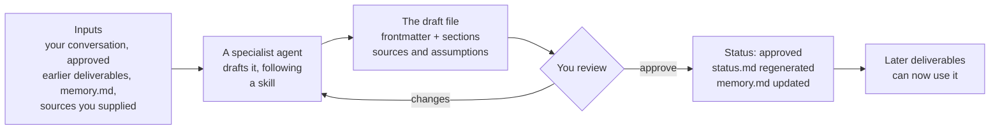

# How each output is built

Every output in AI-PLC is built the same way. Knowing the recipe once explains all of them.

## The recipe



1. **Inputs.** The orchestrator hands the agent only what it may use: your answers, the **approved** files it depends on, `memory.md` (what the project has learned) and any source you named. Nothing that is still a draft.
2. **A specialist drafts it.** Each agent follows a skill, which is a written procedure for that kind of work. Where the profile says `auto`, it drafts from the conversation and research. Where it says `assist`, it drafts but needs your inputs or evidence. Where it says `human`, people outside the tool are needed, so it writes a kit and tracks status.
3. **Every draft has the same shape.** A small header (the file's `id`, `mode`, `status`, `version`, `depends_on` and `sources`), then the content, which always separates what is **known**, what is **assumed** and what is **open**, and, in most deliverables (24 of 30 in the sample run), ends with **what the PM should check first**. The agent also gives that list in its summary in chat.
4. **You review it.** You approve it or ask for changes. A change makes a new version. Only your approval moves the status to `approved`.
5. **The files stay current.** The orchestrator regenerates `status.md`, and adds your decisions, constraints and rejected options to `memory.md`.
6. **A different agent checks at every stop.** Before each checkpoint and gate, a new reviewer agent checks the phase's approved files. See [Decisions and reviews](decisions.md).

## Who builds what

| Output | Built by | Using the skill |
| --- | --- | --- |
| 1.1 Problem and opportunity | Discovery agent | `idea-intake` (asks you a short set of questions) |
| 1.2 to 1.4 | Discovery agent | `market-and-customers` |
| 2.1 to 2.10 | Strategy agent | `strategy` |
| 3.1 to 3.6 | Solution agent | `solution` |
| 4.1 to 4.10 | Viability agent | `viability` |
| Review before each stop | Reviewer agent (a new one every time) | `review` |
| Decision pack at each stop | Orchestrator | `gate-pack` |
| Outcome Pack | Outcome agent | `outcome-pack` |
| Delivery material | Delivery agent | `delivery-scrum`, `delivery-ai-dlc` or `delivery-plain` |

The full lists are in [Agents](../reference/agents.md) and [Skills](../reference/skills.md).

## Three kinds of deliverable

| Mode | What the tool does | Example from this run |
| --- | --- | --- |
| `auto` | Drafts it from the conversation and sourced research | 1.1 Problem and opportunity, 4.5 Market viability |
| `assist` | Drafts it, but needs your inputs or evidence | 2.10 Initial business case, 4.4 Product viability |
| `human` | Gives a template and tracks it. People provide the substance | 3.3 Usability tests, 4.1 Legal and security assessment |

For the two `human` deliverables in this run the tool wrote the plan, the questions and the capture templates. It cannot run sessions or give legal advice. Because this was a dummy run, the results were filled in with invented placeholders, and each one is labelled SYNTHETIC.

## What a deliverable's header looks like

??? note "Go deeper: the header of deliverable 4.1 (shortened)"
    ```yaml
    ---
    id: "4.1"
    profile: ai-plc-v1.0
    status: approved   # approved by PM in chat, 2026-10-16, for the dummy run
    version: 1
    updated: 2026-10-16
    mode: human
    depends_on: ["3.6"]
    data: synthetic
    sources:
      - "3.6 MVP scope v1 (approved 2026-10-15 for the dummy run): six choices, conditions table"
      - "legislation.gov.uk, Package Travel and Linked Travel Arrangements Regulations 2018, reg 18 ..., accessed 2026-10-16"
      - ... 31 more entries, each with a date
    ---
    ```
    `depends_on` is what drives the order of work, what can run in parallel, and what becomes `stale` if an earlier file is revised. `sources` is what a reviewer checks. `data: synthetic` is what keeps the placeholder label attached.

??? note "Go deeper: a complete small deliverable, 1.1 Problem and opportunity (shortened)"
    This is the first deliverable of the run. It was drafted from a short conversation: the only source is the PM's own answers.

    ```markdown
    ---
    id: "1.1"
    status: approved
    version: 1
    mode: auto
    depends_on: []
    sources:
      - "PM in chat, 2026-10-15 (idea, intake rounds 1 and 2)"
    ---

    # 1.1 Problem and opportunity statement

    ## The problem
    Families planning holidays, solo leisure travellers and people on multi-city
    or long-haul trips have to put a trip together themselves, across many
    disconnected places. ...

    ## What we are assuming
    - **Other travellers in the three groups share the PM's experience, and feel
      it strongly enough to change how they plan.** Check against the 1.4
      research summary, then with customer interviews or a short survey.
    - **The pain is greatest at the planning and stitching-together stage,
      rather than at any single booking.** Check through interviews ...

    ## Open questions
    - Which of the three groups feels the problem most and should come first?
      (PM, informed by 1.3)
    ```
    Notice that each assumption says **how to check it**.

## Versions, rework and memory

- **Versions.** A deliverable that was changed after review has a higher `version`. In this run, 3.3 Usability tests and 4.5 Market viability are at v2, the Outcome Pack index is at v3.0, and several delivery files are at v2.
- **Stale.** If you approve a change to something that others depend on, those files are marked `stale` and checked again. Nothing quietly keeps using an old version.
- **Memory.** `memory.md` held 122 dated entries by the end of the run: your decisions, constraints, assumptions and rejected options, each with its date and source. Agents read it at the start of every session so they do not ask you again.
