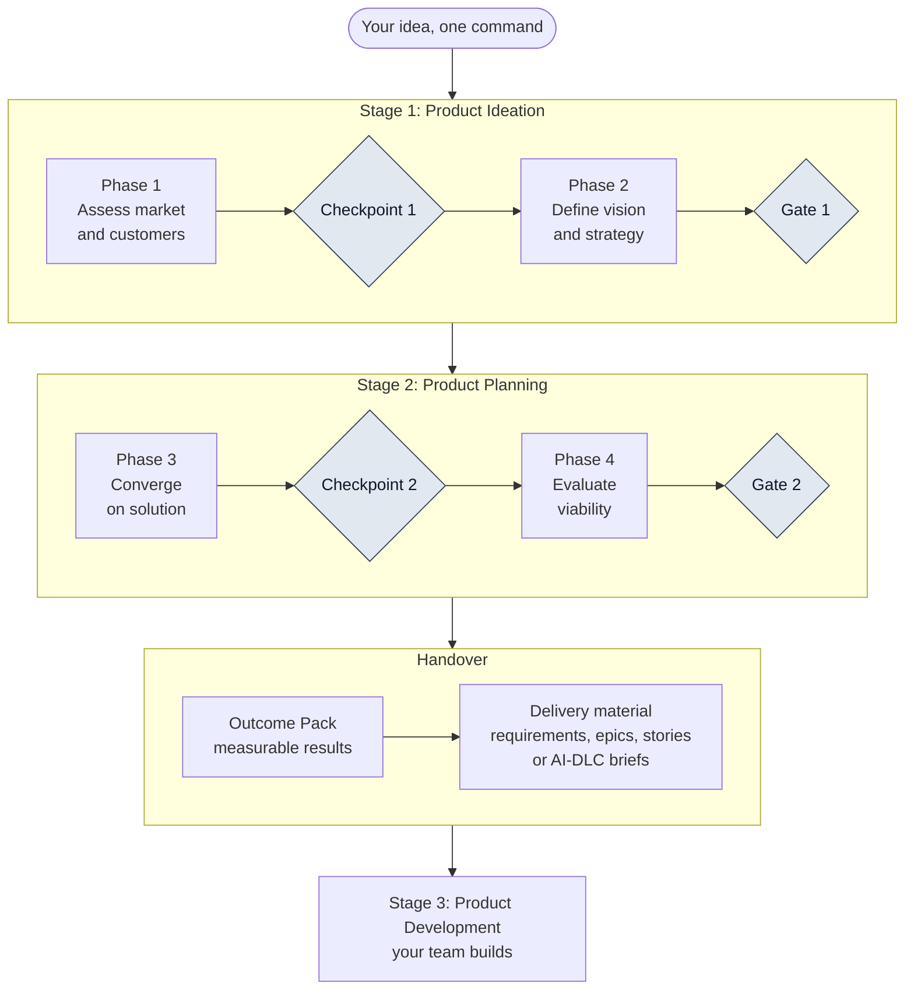
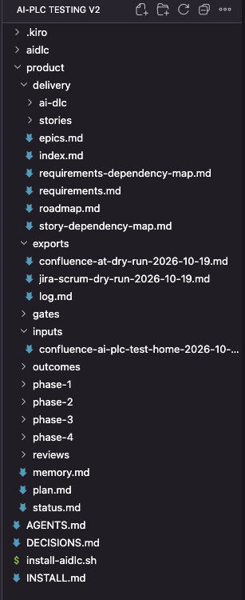

# What AI-PLC produces

This section shows what AI-PLC produced on **one complete run**, so you can judge the output before you try it. Every output is explained: what it is, how it was built, and how it connects to the others.

!!! warning "This was a dummy run"
    The idea was chosen to test AI-PLC: an AI-assisted leisure travel platform that plans the whole journey, starting with UK families. The web research is real and carries its source and date. From phase 3 onwards the inputs, such as test results, costs and targets, are **placeholders labelled SYNTHETIC**. Nothing here is advice about the product, and no figure here should be used as evidence.

## Read it at the depth you want

| Level | What you get | Where |
| --- | --- | --- |
| 1. The map | The whole run on one page | This page |
| 2. Each stage | Every output, what it is and how it was built | [Stage 1: Ideation](ideation.md), [Stage 2: Planning](planning.md), [Decisions and reviews](decisions.md), [The Outcome Pack](outcome-pack.md), [Delivery material](delivery.md) |
| 3. The detail | Real excerpts, diagrams, and one outcome followed from idea to user story | The **Go deeper** blocks on each page, [Dependencies at every level](dependencies.md), [Follow one outcome end to end](trace-one-outcome.md) |

## The run in one picture

A person decides at every diamond. The AI drafts, checks and recommends. It never approves.

## The run in numbers

All figures were counted from the files the run wrote.

| What | Count |
| --- | --- |
| Deliverables in phases 1 to 4 | 30 (11 drafted automatically, 17 drafted with the PM's input, 2 that need people outside the tool) |
| Words across those deliverables | about 115,000 |
| Sources listed in their frontmatter, each with a date | 493 |
| Decision records (2 checkpoints, 2 gates) | 4 |
| Independent reviewer reports in the folder | 4 (a review before Checkpoint 2, a review before Gate 2, and two delivery reviews) |
| Outcomes in the Outcome Pack | 9 |
| Requirements, epics, user stories (Scrum adapter) | 90, 13 and 115 |
| Dependencies worked out and checked | 58 between deliverables, 8 between outcomes, 133 between requirements, 35 between epics, 228 between stories |
| Delivery drops and roadmap steps | 3 drops, 21 steps |
| Dated project-memory entries | 122 |
| Markdown files in the whole `product` folder | 74, about 241,000 words |

## Everything it produced

| Output | What it is | Page |
| --- | --- | --- |
| `plan.md`, `status.md`, `memory.md` | The run's tracking files: the route, the live status of every deliverable, and what the project learned | [Worked example](../guide/worked-example.md), [How each output is built](how-built.md) |
| Phase 1 and 2 deliverables (14) | Market, customers, use cases, scope, strategy, business model, initial business case | [Stage 1: Ideation](ideation.md) |
| Phase 3 and 4 deliverables (16) | Capabilities, solution, tests, pilot, MVP, then legal, risk, build, money, value, pricing, final business case | [Stage 2: Planning](planning.md) |
| Decision records and reviews | What each person decided, and what the independent reviewer found first | [Decisions and reviews](decisions.md) |
| Outcome Pack | Nine measurable outcomes, their dependency map, delivery drops, carried items | [The Outcome Pack](outcome-pack.md) |
| Delivery material | Requirements, epics, 115 stories with acceptance criteria, dependency maps, roadmap, traceability | [Delivery material](delivery.md) |

## What to notice

- **Everything is sourced.** Each deliverable lists its sources with the date they were read. Where a page could not be read, the file says "not confirmed" instead of guessing.
- **The AI recommends, people decide.** At Gate 2 the AI's draft recommendation was "rework". The decision-makers reported a full approval. Both are recorded. See [Decisions and reviews](decisions.md).
- **Dependencies are worked out, not assumed.** Order, parallel work, critical paths and what can start now all come from them. See [Dependencies at every level](dependencies.md).
- **A separate reviewer checks the work first.** It recomputes the arithmetic and counts from the files themselves, and reports findings without fixing anything.
- **Labels travel with the data.** SYNTHETIC stays attached to every line that rests on invented inputs, all the way down to individual user stories.

## What your project folder looks like

After a full run, the `product` folder in Kiro looks like this: one folder per kind of output, and the three tracking files at the top.

{ width="260" }
