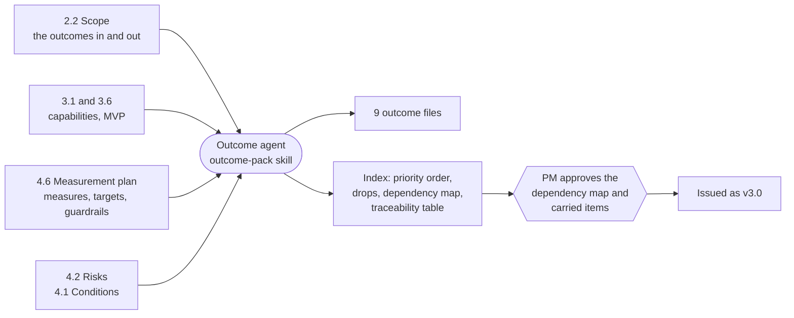
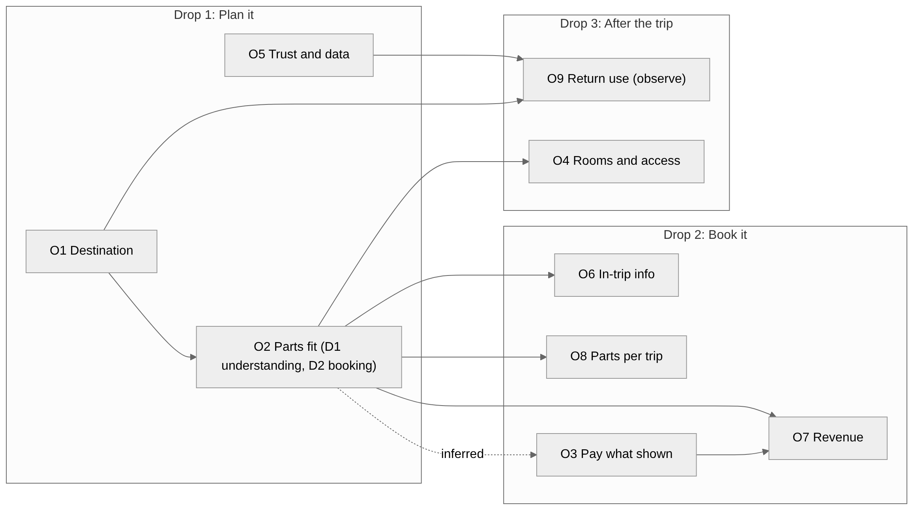

# The Outcome Pack

**What it is:** the handover from planning to development. It turns an approved plan into **nine measurable outcomes**, each with a measure, a baseline, a target and a horizon, in the order they should be delivered. It is built by the **outcome agent** with the `outcome-pack` skill, and it can only start after Gate 2 is approved.

!!! warning "SYNTHETIC targets"
    Every target below is a placeholder taken from deliverable 4.6, which the PM did not set. They show the shape of the output. They are not recommendations.

## The nine outcomes

| ID | Outcome | Measure | Target | Drop |
| --- | --- | --- | --- | --- |
| O1 | Confident destination with less effort | Median active time from plan started to destination chosen | Under 60 minutes | 1 |
| O5 | Families trust the assistant and control their data | Share choosing "keep my family's details" | Half or more | 1 |
| O3 | Families pay what they were shown | Unexplained gap between charged and confirmed total | Zero | 2 |
| O2 | Trip parts booked, fit together, families know what is left | Share who correctly say what is still to book | 9 of 10 | 1 and 2 |
| O7 | Revenue from trips booked on the platform | Planned-to-booked conversion | 10% | 2 |
| O4 | Rooms and access work for the whole family | Share saying rooms were as booked | 9 of 10 | 3 |
| O6 | Minimal in-trip information | Share finding the trip help useful | Half or more | 2 |
| O8 | More of each trip booked on the platform | Service types per booked trip | Two or more in half of trips | 2 |
| O9 | Families come back (observe only) | Share starting a second plan | No target | 3 |

The order is the **priority order**, and the pack explains why: the first two are what the smallest release can deliver and measure; revenue comes after the outcomes it cannot happen without; return use comes last because a 13-week pilot can only observe it.

Each outcome also has its own file (O1 to O9). The index holds the table, the dependency map, the traceability table and the carried items.

## How the Outcome Pack is built



Nothing in an outcome is new. The agent **assembles** it from approved deliverables, and the pack says where each part came from. Outcome O1, for example, takes its target from 4.6, its customers from 2.2, its evidence from 1.x and 2.x, and its constraints from 4.1. A reviewer can check each line against its source.

## Delivery drops

The pack groups outcomes into three drops, each a release families can see.

| Drop | When | Outcomes | What families can see |
| --- | --- | --- | --- |
| 1. Plan it | End of month 4 | O1, O5, O2 (knowing what is left) | Describe who is going, destination cards with "why this fits your family", a day-by-day plan, the full price, "Nothing is booked yet" |
| 2. Book it | Months 5 to 6, only if the month-2 checks clear | O3, O2 (booking), O7, O8, O6 | One checkout for stays, car hire, activities and rail, with one honest total |
| 3. After the trip | Months 7 to 9 | O4, O9 | A post-trip check on rooms and access; an easier start to the next trip |

The pack also says what blocks a drop from **outside** the pack. For example, the planning drop cannot start with real families until data protection is in place, and booking cannot start until an assistance route for organiser bookings exists.

## Outcome dependencies

{ width="760" }

*Arrows point from the outcome that is needed to the outcome that needs it. Boxes group outcomes by delivery drop. The dotted arrow is a dependency the pack inferred but the files do not declare.* [Open full size](../assets/showcase/outcome-dependencies.png){ target="_blank" }

How to read it: O1, O5 and O3 have no outcome dependencies, so they can start first. O2 needs O1. O4, O6 and O8 all need O2. O7 (revenue) needs both O2 and O3. O9 needs O1 and O5. The dotted arrow from O2 to O3 is the inferred one, explained below. The pack states the result: **no loops, and every outcome traces back to O1, O3 or O5.**

??? note "Go deeper: the pack checks that the drops respect the dependencies"
    | Check | Result |
    | --- | --- |
    | O2 (Drop 1 understanding) after O1 (Drop 1) | Holds: same drop, so build O1 first |
    | O4 (Drop 3) after O2 booking (Drop 2) | Holds |
    | O6, O7, O8 (Drop 2) after O2 booking (Drop 2) | Holds inside the drop if O2's booking part comes first |
    | O7 (Drop 2) after O3 (Drop 2) | Holds inside the drop if O3 comes first |
    | O9 (Drop 3) after O1 and O5 (Drop 1) | Holds |

    From this the pack derives an order inside Drop 2: O2's booking part and O3 together first, then O7, O8 and O6.

    Notice also the column "Inferred, not declared in the file". O3's measure only exists once booking is live, which is O2's booking part. The dependency is not declared in O3's file, so the pack flags it as inferred rather than silently adding it.

??? note "Go deeper: the traceability table, from outcome back to evidence"
    For each outcome, the pack links backwards to every kind of source:

    | Outcome | Use cases | Delivering capabilities | Risks | Conditions |
    | --- | --- | --- | --- | --- |
    | O1 Confident destination | UC1, UC2 | C1, C2, C3, C5, C8 | R1, R2, R5, R6, R22, R25, R27 | 2, 7, 9 |
    | O3 Pay what was shown | UC2, UC3, UC6 | C6, C7, C12, C16 | R7, R8, R16, R17, R18, R21, R24 | 3, 4, 5, 6, 8 |
    | O7 Booking revenue | UC6 | C12, C6, C16 (inferred) | R5, R8, R10, R14, R16, R17, R18, R30, R31, R33 | 3 |

    The coverage check then confirms that **every MVP capability traces to at least one outcome**, and lists the capabilities that are deliberately left out.

??? note "Go deeper: a real outcome file, O1 (shortened)"
    Every outcome file has the same parts: a statement, why it matters, measures with baselines and targets, evidence, constraints, and risks.

    ```yaml
    id: O1
    title: Confident destination with less effort
    version: 2
    mode: assist
    base_outcome: "2.2 O1"
    priority: 1
    drop: "1 (Plan it, end of build month 4)"
    metric: Median active time from plan started to destination chosen, per family (4.6)
    baseline: "Product baseline unknown. Outside reference only: 303 minutes and 141 pages ..."
    target: "Median active time under 60 minutes. SYNTHETIC (dummy run, not evidence)"
    horizon: "by the end of pilot stage A (pilot week 4)"
    depends_on: []
    ```

    > **Outcome statement.** UK wedge families choose a destination they feel confident in with a median of under 60 minutes of active planning (SYNTHETIC target, dummy run, not evidence).

    The baseline is honest: the product has no baseline yet, so the file gives an outside reference and says it is "not UK families, not like-for-like".

    | Measure | Target |
    | --- | --- |
    | Time to destination (median active time) | Under 60 minutes |
    | Outside sites used (exit survey) | Median 3 or fewer |
    | Confidence: share answering 4 or 5 of 5 | 7 in 10 |
    | Destination changed after being chosen | Under 1 in 5 |
    | Fact errors per 100 reviewed AI conversations | Under 2; zero safety facts |

**Next:** [Dependencies at every level](dependencies.md)
