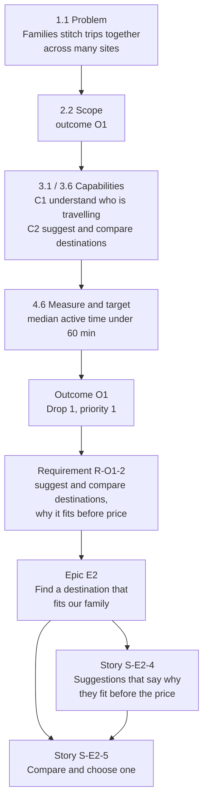

# Follow one outcome end to end

The best test of a planning tool is whether you can pick **one result** and follow it from the idea to a single user story, and back. This page does that for outcome **O1, Confident destination with less effort**.

!!! warning "SYNTHETIC"
    O1's target (under 60 minutes) is a placeholder, and the scope behind it rests on synthetic test results. The chain is real. The numbers are not evidence.

## The chain

Each arrow can be followed in both directions, because each item names where it came from.

| Level | Item | Where it comes from |
| --- | --- | --- |
| Problem | Effort of putting a family holiday together across many places | 1.1 Problem and opportunity |
| Scope | Outcome O1 | 2.2 Outcome-oriented scope |
| Capabilities | C1 understand who is travelling, C2 suggest and compare destinations, C8 say when unsure | 3.1 Prioritised capabilities, kept in the 3.6 MVP |
| Measure | Median active time from plan started to destination chosen, under 60 minutes | 4.6 Measurement plan |
| Outcome | O1, priority 1, Drop 1 (Plan it) | Outcome Pack |
| Requirements | 14 requirements, for example R-O1-2 | D.1 |
| Epic | E2 Find a destination that fits our family (6 requirements, 9 stories) | D.3 |
| Stories | S-E2-4 and S-E2-5, among 21 stories for O1 | D.4 |

## What O1 depends on, and what depends on it

| Level | Needs | Is needed by |
| --- | --- | --- |
| Outcome | Nothing | O2 (parts fit together), O9 (return use) |
| Requirement R-O1-2 | R-O1-1 Party description (hard); R-O3-7a prices labelled as estimates (hard); R-O1-8 allowed content sources (soft) | R-O1-9 web and phone journey; R-O1-10 time-to-destination events; R-O5-12 |
| Epic E2 | E1 Our family's data is protected (hard) | E3, E4, E5, E6 and others |
| Story S-E2-4 | S-E2-1 tell the product who is travelling (hard); S-E2-6 estimate labels (hard); S-E2-7 allowed content (soft) | S-E2-5, S-E2-5, S-E2-8, S-E2-9, S-E5-1 |

So the plan says **what must be built before destination suggestions**: a way to describe the party, estimate labels on prices, and, before real families use it, data protection. And it says what suggestions unlock: comparing, the time-to-destination events that measure the outcome, and the whole-trip plan.

## Where it sits on the roadmap

| Step | Story | Why then |
| --- | --- | --- |
| 1 | S-E2-6 estimate labels | Needs nothing; S-E2-4 needs it |
| 2 | S-E1-4 (analytics only with its own consent) | Needed before S-E2-1 |
| 4 | S-E2-1 tell the product who is travelling | Needs S-E1-4 |
| 5 | S-E2-4 suggestions that say why they fit | Needs S-E2-1 and S-E2-6 |
| 6 | S-E2-5 compare and choose | Needs S-E2-4 |
| 7 | S-E2-8 record time to destination, S-E2-9 exit survey on outside sites and confidence | Need S-E2-5 |

The stories in step 7 are what **measure O1's target**. The outcome is not just built: the plan also builds the instrument that proves whether it was reached.

## Blockers on the way

- **S-E2-7**, the allowed-content story, is blocked by an open question (Q8, whether scraping planning content is kept). Meanwhile the suggestions use only partner or in-house content, which is written into S-E2-4's acceptance criteria.
- **Real families** cannot use any of this until data protection is in place (an external dependency stated in the Outcome Pack).

## Why this matters

If someone asks "why are we building destination suggestions?", the answer is a path through files: the problem in 1.1, the outcome and its target, the requirement, the story and its tests. If someone asks "what happens if we drop the estimate labels?", the answer is also in the files: the story that needs them cannot be built.

**Back to:** [What AI-PLC produces](index.md)
