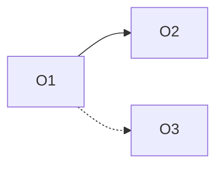
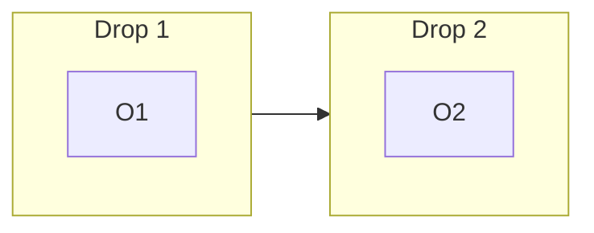

# Outcome pack

## Goal

Give delivery a short list of measurable results to build toward, each with its evidence, limits and risks, so it can take one at a time.

## Steps

1. **Check the gate.** Read `/product/gates/gate-2.md`. Continue only if the PM-reported outcome allows it. Note any conditions.
2. **List candidate outcomes.** From 3.6 (MVP scope) and 3.1 (capabilities), list the results the MVP is meant to produce, using the outcomes in 2.2 as the base. Group capabilities under the result they serve. Aim for 5 to 12 outcomes. Fewer, sharper outcomes beat a long list.
3. **Make each one measurable.** Take the metric, baseline, target and horizon from 4.6. Where 4.6 has none, write "to be set by the PM". Never fill a number.
4. **Order them.** Priority 1 is the most important. Mark `mvp: true` for what the first release needs, from 3.6. Show the reason for the order in the index.
5. **Evidence, constraints, non-goals, risks.** Evidence points to deliverable ids or dated sources. Constraints come from 4.1 and `memory.md`. Risks come from 4.2. Non-goals come from the "not in the MVP" list.
6. **Carry the open items.** Every open question and condition from Gate 2 that affects an outcome appears in that outcome. Anything affecting the whole pack goes in the index assumptions.
7. **Build the dependency map** (below) from the outcomes and show it with them.
8. **Build the outcome roadmap** (below) from the dependency map, the MVP flags and the delivery drops, and show it with the map.
9. **Check quality** (below), then show the outcomes to the PM for review, one at a time or in a short batch. Ask: approve, or what to change?
10. **Issue the index** only after every outcome is `approved` and the PM confirms. Then set the index status to `issued`.

## Dependency map

`/product/outcomes/dependency-map.md`

Show which outcomes must come before others, so delivery can order the work and run independent outcomes in parallel.

- A **hard** dependency means outcome B cannot deliver its result until outcome A has. A **soft** dependency means B is better or cheaper after A but can start without it.
- Take dependencies from 3.1 (capabilities that need others), 4.3 (implementability: dependencies and hard parts), 4.2 (risks) and the PM. Mark each one `proposed` unless the PM has confirmed it. Do not invent dependencies; if there is no evidence, say "none found".
- Each outcome file lists its hard dependencies in `depends_on`. The map and the files must match.

```markdown
---
id: outcome-dependency-map
profile: ai-plc-v1.0
status: draft          # draft | reviewed | approved | stale
version: 1
updated: <YYYY-MM-DD>
---

# Outcome dependency map

## Dependencies
| Outcome | Depends on | Type (hard / soft) | Why | Source | Confirmed by PM |
| --- | --- | --- | --- | --- | --- |

## Diagram

(solid arrow = hard, dotted = soft)

## What can start now
Outcomes with no hard dependency.

## Critical path to the MVP
The longest chain of hard dependencies among MVP outcomes, and what could shorten it.

## Parallel groups
Outcomes that can run at the same time.

## Checks
- No loops: say "no cycles found" or list the loop.
- Every MVP outcome's hard dependencies are also MVP outcomes, or the gap is flagged.
- Anything that depends on an unresolved Gate 2 condition or open question is named.
```

The map is an AI-PLC deliverable. The PM reviews and approves it like the outcomes.

## Outcome roadmap

`/product/outcomes/roadmap.md`

A time-ordered view of when each outcome is delivered and when its result is expected, built on the dependency map. It is a plan to discuss with the PM, not a commitment.

- **Timeframes come from the PM.** Use the drops and timeframes the PM has set (for example "end of month 4", "months 5 to 6") and the horizons in the outcome files. Never invent dates or durations. If there are none, order by dependency and drop and write "timing to be set by the PM".
- Order follows hard dependencies, then priority, then MVP. An outcome never sits earlier than one it hard-depends on.
- Show what gates each step: Gate 2 conditions, open questions, clearances or partner dependencies named in the pack.
- Show when each outcome's result can first be measured, using the horizon and measure from 4.6.

```markdown
---
id: outcome-roadmap
profile: ai-plc-v1.0
status: draft          # draft | reviewed | approved | stale
version: 1
updated: <YYYY-MM-DD>
---

# Outcome roadmap

## Roadmap by drop
| Drop | Timeframe (from the PM) | Outcomes | MVP? | Needs first (dependencies, conditions) | First measurable (measure, horizon) |
| --- | --- | --- | --- | --- | --- |

## Diagram


## Milestones and gates
Decision points, clearances and conditions that must be met before a drop starts.

## Risks to the roadmap
From 4.2 and the carried items.

## What is not scheduled
Outcomes with no timeframe yet, and why.

## Checks
- No outcome is earlier than one it hard-depends on.
- Every outcome appears once.
- Every timeframe is from the PM or marked "to be set".
```

The roadmap is an AI-PLC deliverable. The PM reviews and approves it like the outcomes and the map.

## Traceability and carried items (in the index)

The index also holds:
- **Traceability:** for each outcome, the capabilities in 3.1 that serve it, the use cases in 2.1 and the evidence ids.
- **Carried items:** each Gate 2 condition and unresolved review finding, with the outcomes it affects.

## Writing the outcome statement

One sentence: who gets what change, by how much, by when. Example: "Families booking a two-week holiday finish planning in under one evening, down from several days, within 90 days of launch." The numbers must come from 4.6 or the PM. If they are missing, write the sentence without them and mark the target "to be set by the PM".

## Quality checks

- Each outcome is a result, not a feature (no screens, buttons or technology in the statement).
- Every metric, baseline, target and horizon traces to 4.6 or the PM, or is marked "unknown" or "to be set".
- MVP flags match 3.6.
- Risks from 4.2 and conditions from Gate 2 are carried, not dropped.
- SYNTHETIC or unconfirmed inputs are labelled.
- Outcomes do not depend on each other in a loop. Dependencies are listed in `depends_on`.
- The index table matches the files.
- The roadmap matches the dependency map and the drops, has no timeframe the PM did not set, and lists every outcome once.
- The dependency map matches each outcome's `depends_on`, has no loops, and marks unconfirmed dependencies as proposed.
